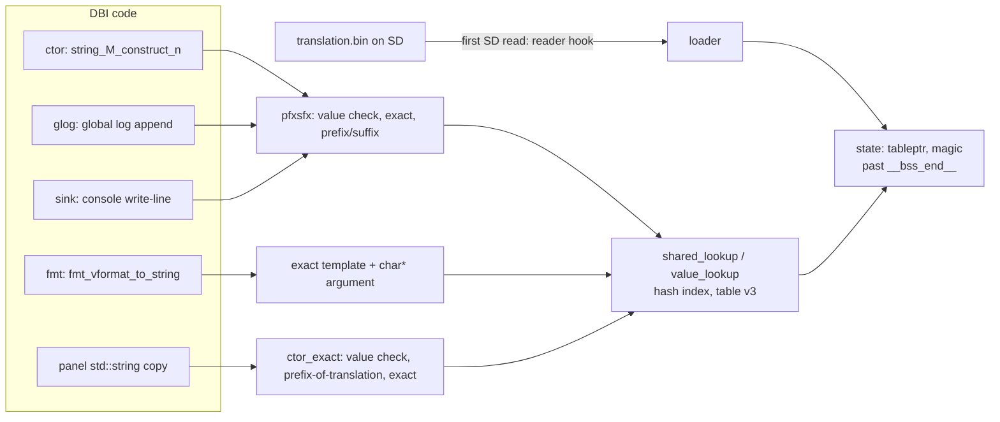

# Porting the translation patch to a new DBI release

This document collects everything learned while porting the runtime-translation patch from DBI 905 to DBI 912 (October 2026). Use it when a new DBI release comes out. Every finding below was verified on a console or in an emulator; open questions are marked as such.

## 1. Quick procedure

1. Download the pristine Russian `DBI.nro` from [rashevskyv/dbi releases](https://github.com/rashevskyv/dbi/releases). Record its SHA-256.
2. Run the site finder from the newest supported release:

   ```bash
   python tools/porting/find_sites.py 912 /path/DBI.912.ru.nro /path/DBI.NEW.ru.nro NEW
   ```

   It prints a proposed `Version` entry. Every line must say `OK`, the cave must have `outside references: none`, and the free bytes past `__bss_end__` must be ≥ 0x240 (state 0x20, persist 0x20, scratch 0x200; 905/912 also left a 0x40 gap, 920 has only 0x248 free).
3. Add the entry to `vendor/dbi_translate/versions.py` (pick `ctors` from the candidates: the copy with the same call count as the old panel copy) and the SHA-256 to `DBI_SHA256` in `scripts/patch_dbi.py`.
4. Run the tests with the release NROs:

   ```bash
   DBI_912_NRO=/path/DBI.912.ru.nro DBI_NEW_NRO=/path/DBI.NEW.ru.nro python -m pytest -q tests
   ```

   Add the new version to `tests/test_runtime_rules.py` and `tests/test_patch_dbi.py` the same way 905 and 912 are there.
5. Build and test on a console (section 5). Then look for new strings (section 6).

## 2. How the patch works



- **Hooks.** Five sites (`reader`, `fmt`, `glog`, `ctor`, `sink`) branch into the runtime. One more class of hook (`Version.ctors`) covers selected copies of `std::string(const char*, size_t)`.
- **Runtime location.** The runtime lives in an unreferenced libde265 function (912 `0x939DAC`, 905 `0x90B4A4`, 5208 bytes, identical body). The `.text` zero tail is too small (912: 0x244 bytes; the runtime needs ~0x900).
- **State.** Lock, magic, table pointer, the persistent string and a 0x200-byte scratch buffer sit between MOD0 `__bss_end__` and the image end. MOD0 `bss_end` is raised to the image end so crt0 zeroes them on boot.
- **Table.** `translation.bin` (DBITRNS). Version 3 adds an FNV-1a hash index; version 2 still loads (linear scan). NROs patched before version 3 reject version 3 tables.

## 3. Findings and pitfalls

Each item: symptom → cause → fix.

1. **State inside DBI's TLS block.** The original patcher put its state on the last bss page, below `__bss_end__`. That range is the main thread's static TLS block, where DBI decrypts its UI strings (905: TLS offsets 0x348F0–0x34FC8; 912: from 0x34660, at least 19 string slots). → Strings and patcher state overwrite each other; the table pointer can be lost and reloaded. This is the likely cause of the 905 settings stutter (issue #28): it disappeared on 912 with the fix. → State past `__bss_end__`; `patch_nro` now rejects any state area below it. Only the MOD0 layout proves an area free: an ADRP scan cannot, because TLS slots are reached through `tpidrro_el0`.
2. **Code cave.** The 912 `.text` zero tail is 0x244 bytes. → The runtime goes into a dead function. `find_sites.py` checks that no branch, ADR, ADRP+ADD or data pointer reaches it.
3. **Game info panel labels** (`Контент`, `Тикеты`, `Сохранения`, `Имя`, `Автор`, `Версия`, `Язык`; issue #25 §3). DBI has ~43 copies of `std::string(const char*, size_t)` (one per translation unit); the panel uses one the `ctor` hook does not cover (912 `0x43B6F0`, 905 `0x435CA0`, 205 calls each). → Exact-match hook on that copy only.
4. **Hooking all ctor copies hangs DBI** (black screen, no crash report). Found by a console bisect: six builds with 7–8 copies each, NACP names `DBI T1`…`DBI T6`. Only the group `0x4F2910`–`0x5BC160` hangs; the cause is not known (the hook preserves all live registers at all 5094 call sites — checked). → Add copies one at a time, each with a console test.
5. **Double translation for Cyrillic targets** (`Такмпити на SD-карту`). Several hooks see the same text. For UA/BE/KK a translation can start with a Russian key: `Дампити` + key `Да` → `Такмпити`. English never hits this. → `value_lookup`: text that already is a translation is left alone.
6. **Words cut to the Russian length** (`Видалит`, `Відкрит`). DBI copies menu words twice: `std::string tmp(slot, 14); std::string w(tmp.data(), 14);` The length 14 is a constant in the code. → When a hooked copy takes a prefix of a whole translation, it copies the whole translation.
7. **Prefix/suffix keys matching inside words.** → A prefix or suffix hit counts only on a word boundary.
8. **Menu lag.** Every untranslated line with a byte ≥ 0x80 ran the prefix/suffix matcher, up to 2·L linear scans of ~1400 entries, every frame. Chinese/Japanese/Korean tables never hit, so they pay the most. → Hash index (table v3): a 71-byte miss went from 1.74 M to 42 K instructions, an exact hit from 23 K to 0.9 K.
9. **Version line `912-ru`.** It is the fmt template `{}-{} FW:{}{} SDK:{}` (912 TLS slot 0x11B0, function `0x9D8C0`) with `"912"` and `"ru"` as arguments. → Per-language table entry `{}-ua{:.0} FW:{}{} SDK:{}`; `{:.0}` consumes `"ru"` and prints nothing. The validator counts `{:.0}` as `{}`. Function `0x9DF00` builds an HTTP parameter with its own `"ru"`: leave it.
10. **Panel line `Общее время игры`.** The keys existed only as a prefix (`... : -`). → Templates `... : {}` and `... : {} ({})` (the second one is a guess from the screen output `- (2)`; confirm on a console).
11. **921 activity-log columns and forwarder settings stay Russian.** The columns are copied with constant byte lengths and assembled into one padded line, so the existing constructor hooks miss the individual labels. The forwarder labels are assembled from decrypted word fragments through other constructors. → `Version.string_calls` selects seven UI calls: three before width measurement and four before menu construction. `translate_string` replaces a matching string through DBI's own append, keeping its buffer ownership. Each trampoline preserves the volatile GPRs, SIMD registers and NZCV, then tail-calls the original function. Only 921 opts in; do not reuse these offsets for another release. Tested from Album on a console with the French table. Other languages use the same hooks, but their visual layout is not console-validated.

## 4. Data pipeline notes

- `python -m src.main export` rewrites `translations/*.csv` with CRLF, while the repository stores LF. Rebuild the files from the index blob plus the changed rows (`git show :translations/xx.csv`), or every line shows as changed.
- `tests/test_indonesian_translation.py` and `tests/test_temperature_aliases_and_sync.py` hard-code the number of dictionary keys. Update them when you add rows.
- New source rows go to `data/ua.csv`, then `python -m src.main sync`. Fill other languages in `data/dictionary.xlsx`, then `validate`, `export`, `build`.

## 5. Testing on a console

- **FTP.** DBI's own FTP server: anonymous, port 5000 (`ftp://<console-ip>:5000/switch/DBI/`). Back up `DBI.nro` and `translation.bin` before you overwrite them.
- **Screenshots** with emuMMC are in `emuMMC/<id>/Nintendo/Album/` on the SD card (`nintendo_path` in `emuMMC/emummc.ini`), not in `Nintendo/Album/`.
- **Side-by-side builds.** Put several NROs in `sdmc:/switch/DBI/` and give each a different NACP name (the 16 title entries in the asset section, 0x300 bytes apart) so the launcher shows them apart. The table path is fixed (`sdmc:/switch/DBI/translation.bin`), so all builds share one table.
- **Checklist.** Top line `NNN-ua`; main menu; game info panel (tabs, `Мова`, `Загальний час гри`); context menus (Start on the panel, `+` in the game list) for whole words and no lag; settings screen for lag; one install log.
- **Emulators.** Eden cannot run DBI: `fsp-srv` command 11 (`OpenBisFileSystem`) is not implemented, and DBI exits without the NAND partitions. Use the console. Unicorn covers the runtime itself (`tests/test_runtime_rules.py`, `tools/porting/emu_runtime.py`).
- **Crash reports** are in `/atmosphere/crash_reports/`. A black screen without a new report is a hang, not a crash.

## 6. Finding new strings

- A reverse-engineering workspace of DBI 912 exists outside this repository (`D:\git\dev\DBI_reverse`; WSL `~/re-work/dbi-912`, Ghidra 12.1.2 + Switch Loader). `export/tls_strings.tsv` holds ~2900 decoded UI strings with their TLS slots and functions. DBI's UI strings are encrypted per site and decrypted lazily into thread-local slots; many phrases are stored word by word and joined at run time, so a dictionary key is often a whole line that never appears in the binary.
- Compare decoded strings with the dictionary keys (escape `\e` as `\x1b`); only whole lines are worth adding. Word pieces need a screenshot of the screen that shows them.
- New 912 strings added so far: R/W transfer progress templates, `Тема...`, `2ая панель, (+) меню, L3 имя`, the version line, the play-time templates.

## 7. Open items

- The header line `Имя  Автор  Версия  Язык` (issue #25 §2) is not in the dictionary: it needs the exact padding from a screenshot.
- Why hooking the `0x4F2910`–`0x5BC160` ctor copies hangs DBI 912.
- Launching a second DBI NRO (`DBI_good.nro`) from Kefir Hub crashed a Kefir Hub thread (crash report 2026-10-15 15:47: instruction abort outside the DBI module while DBI's main thread ran normally).
